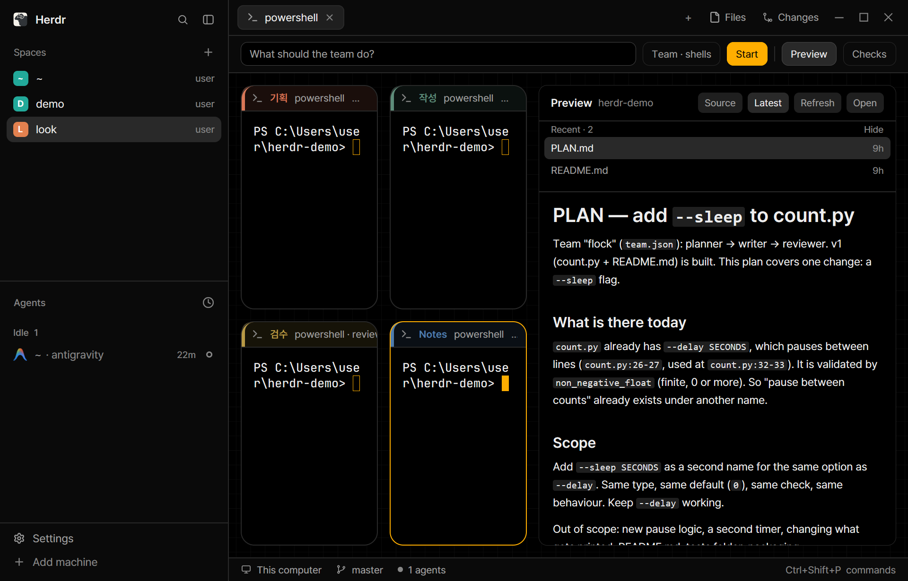

# Team Cockpit for Herdr

Run a team of coding agents in [Herdr](https://herdr.dev) and keep track of it: name each agent
and give it a role, start the whole team from one line, see what it just wrote, and check the
work before you accept it.



Four mods and one layout that puts them together. Take the layout for everything, or any mod on
its own.

| Folder | What you get | Gallery |
|---|---|---|
| [`team-cockpit/`](team-cockpit/) | **Team Cockpit** layout: Herdr's main window in black and amber with the four mods below in place | `herdr-layout` |
| [`team-pane/`](team-pane/) | **Team Pane**: a pane header with the member's name, role and color, and who is working, done or waiting for you | `herdr-mod` |
| [`team-bar/`](team-bar/) | **Team Bar**: type a task, pick a team file, press Start | `herdr-mod` |
| [`preview/`](preview/) | **Preview**: the newest Markdown, HTML, image or document in the folder, beside the agents | `herdr-mod` |
| [`checks/`](checks/) | **Checks**: run the folder's own checks, keep the output as evidence, hand it to the reviewer | `herdr-mod` |
| [`scripts/`](scripts/) | `team_start.py`: one JSON file → a space, a grid of agents, roles, labels | — |

Each gallery folder is laid out like Herdr's home (`mods/<name>/`, and for the layout
`layouts/`, `themes/`), with a `RECIPE.md` (the brief an agent can build it from), a
`preview.png` and a `keys.json`.

## Install

In Herdr, ask your agent:

> add the layout at github.com/gbrinan/herdr-team-pane/tree/main/team-cockpit

or name one mod's folder instead (`team-pane`, `team-bar`, `preview`, `checks`). By hand:

```sh
git clone https://github.com/gbrinan/herdr-team-pane && cd herdr-team-pane
cp -r team-cockpit/mods/* ~/.config/herdr-app/mods/
cp team-cockpit/layouts/team-cockpit.* ~/.config/herdr-app/layouts/
cp team-cockpit/themes/team-cockpit.json ~/.config/herdr-app/themes/
herdr-app do layout.switch '{"name":"team-cockpit"}'
```

Herdr docks a new mod folder into the shown layout the first time it sees it: if stray blocks
appear, remove them from that layout's file (the Team Cockpit layout already has each mod where
it belongs). Merge `team-cockpit/keys.json` into your `keys.json` for the keys below.
`ctrl-shift-l` switches back to your own layout.

## Use

| Do | How | Key (in Team Cockpit) |
|---|---|---|
| Name a pane | hover its header → tag button → name, role, color → Save | `ctrl-shift-m` |
| Start a team | type the task in the bar, click the team chip to pick a team file, Start | `ctrl-shift-i` puts the cursor in the bar |
| See the newest output | Preview chip: it follows the newest file; click a row to pin one | `ctrl-shift-r` |
| Check the work | Checks chip → Run all; click a row to read its output | `ctrl-shift-g` |
| Ask for a review | Ask reviewer in Checks: the results go to the pane with the reviewer role | |

**Team files** say who is on the team. Put a `team.json` in the project folder (or several in
`teams/`); the examples are in [`scripts/teams/`](scripts/teams/):

```json
{ "name": "team", "folder": ".", "grid": { "rows": 1, "cols": 3 },
  "panes": [
    { "slot": 1, "name": "plan", "title": "Planner", "role": "planner", "color": "#D97757" },
    { "slot": 2, "name": "write", "title": "Writer", "role": "writer", "color": "#5E8D7A" },
    { "slot": 3, "name": "review", "title": "Reviewer", "role": "reviewer", "color": "#B99A45" } ] }
```

A role names a herdr-core template (its instructions and its program); the example roles in
[`scripts/templates/`](scripts/templates/) are used when you have none of your own. Titles can
be in any language. From a shell, the same thing is
`python scripts/team_start.py scripts/teams/example.json --task "Add a --verbose flag"`.

**Checks** live with the work, in `herdr-checks.json` in the project folder. Agents can write
and extend it:

```json
{ "checks": [ { "name": "Tests", "run": "python -m pytest -q" },
              { "name": "No whitespace errors", "run": "git diff --check" } ] }
```

**Labels** can also be set from a shell:
`hc label t3 team.title=Planner team.role=planner team.color=#D97757` (`key=` removes one).
They live on the terminal in herdr-core, so they survive restarts and show on every client.

## What runs, and when

Nothing reaches the network. Programs run only on your click:

- Team Pane: `hc label`, when you save in its editor.
- Team Bar: `python team_start.py`, on Start. This starts real agents, which cost what those
  agents cost.
- Checks: the lines in the folder's `herdr-checks.json`, on Run; `hc send`, on Ask reviewer.
  Read that file before running it in a repository you did not write.
- Preview: a file listing (PowerShell on Windows, `find` elsewhere) when the folder changes, a
  copy of the shown image, and the system's opener on Open.

## Limits

- Made and tried on Windows with Herdr 0.1.16. The macOS and Linux paths of Preview's file
  listing and Checks' shell were written but not run.
- Preview shows HTML as words without styling (mods cannot show a web page): Open shows the
  real page in your browser. A picture made after Herdr started can stay blank in the panel.
- The Preview and Checks panels close when you switch spaces: Herdr's tab bar remembers only
  Files and Changes per space.
- Checks keeps results until Herdr restarts, not on disk.

## License

Apache-2.0. Team Pane started as a clone of Herdr's `pane` mod (Apache-2.0); see `NOTICE`.
Pretendard (in `team-cockpit/mods/team-cockpit/fonts/`) is under the SIL Open Font License 1.1.
