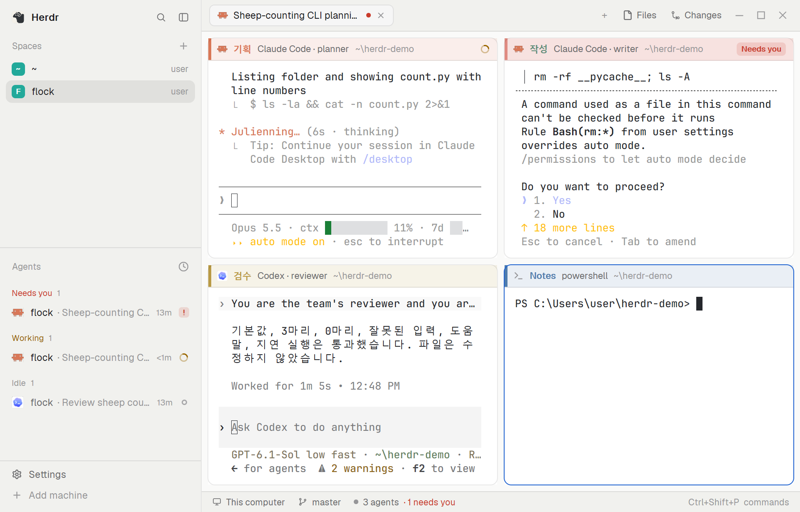

# Team Pane for Herdr

Name your agents, give them roles and colors, and see at a glance who is working, who is done
and who needs you. A pane header mod for the [Herdr](https://herdr.dev) app, a ready layout that
uses it, and a script that starts a whole team in one go.



| Folder | What | Gallery |
|---|---|---|
| [`team-pane/`](team-pane/) | **Team Pane** mod: the pane header, with a team editor | `herdr-mod` |
| [`team-cockpit/`](team-cockpit/) | **Team Cockpit** layout: Herdr's main window with Team Pane headers | `herdr-layout` |
| [`scripts/`](scripts/) | `team_start.py`: one JSON file → a space, a grid of agents, roles, labels | — |

Each gallery folder has a `RECIPE.md` (the brief an agent builds it from) and a `preview.png`.

## Install

Ask your agent in Herdr: *"add the mod at github.com/gbrinan/herdr-team-pane/tree/main/team-pane"*
(or `team-cockpit` for the layout). By hand:

```sh
cp -r team-pane/mods/team-pane ~/.config/herdr-app/mods/
cp team-cockpit/layouts/team-cockpit.json ~/.config/herdr-app/layouts/   # optional
herdr-app check ~/.config/herdr-app/mods/team-pane
herdr-app do layout.switch '{"name":"team-cockpit"}'
```

To use the header in your own layout, set your tab block's pane header to
`{ "content": { "mod": "team-pane" } }`. Optional key: merge `team-pane/keys.json`
(`ctrl-shift-m` → edit the focused pane's team).

## Label a pane

- Hover a header → tag button → name (any language), role, color → Save.
- Or from a shell: `hc label t3 team.title=Planner team.role=planner team.color=#D97757`
  (`key=` removes a label).

Labels live on the terminal in herdr-core, so they survive restarts and show on every client.
Team Pane runs `hc label` only when you save in its editor; it reaches no network and reads no
files.

## Start a team

```sh
python scripts/team_start.py scripts/teams/example.json --task "Add a --verbose flag"
```

Opens a space with a Planner (Claude Code), a Writer (Claude Code) and a Reviewer (Codex), each
with its role as the first prompt and its labels set. Roles are herdr-core templates; the
examples in `scripts/templates/` are used when you have none of your own. See the script's
help for the team file format.

## License

Apache-2.0. Team Pane started as a clone of Herdr's `pane` mod (Apache-2.0); see `NOTICE`.
