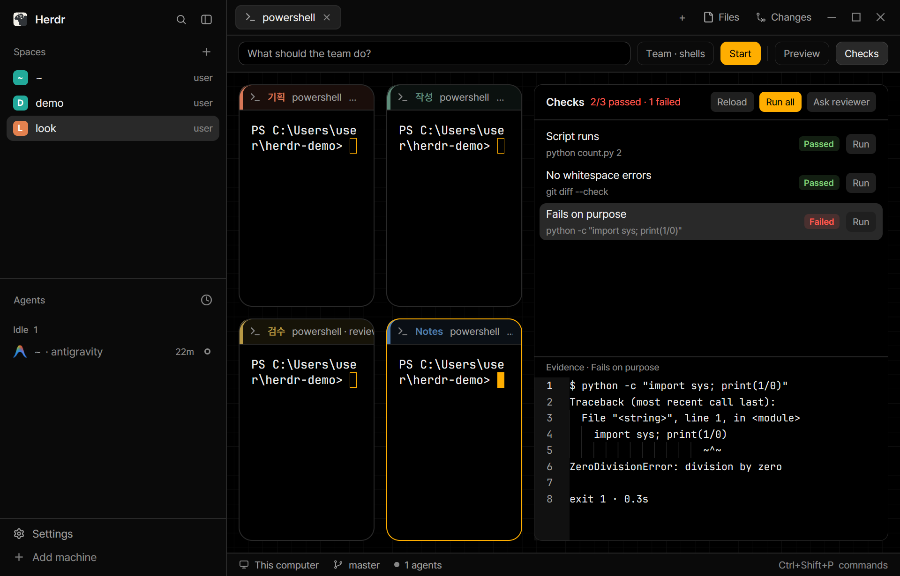

# Checks

The proof that the work is done, in a panel: the folder's own check commands (tests, a linter,
a build), run with one click, each showing Passed or Failed with its output kept as evidence.
One more button hands the results to the team's reviewer.

## What you see

A panel (a rounded card on `background`, 1 px `border`, 13 px text), top to bottom:

1. **Header** (42 px, bottom border): "Checks" semibold; a summary "2/3 passed · 1 failed"
   (`blocked` color when anything failed, else `dim`; the folder's name when there are no
   checks); buttons **Reload**, **Run all** (solid), **Ask reviewer** (24 px high, 6 px radius).
2. **The checks** (at most 280 px, scrolls): rows 44 px high, 8 px radius: the name, under it
   the command in `dim` 11 px; a badge (18 px, 5 px radius, 10.5 px semibold, its color at 15%
   behind): **Not run** (`dim`), **Running** (`working`, breathing), **Passed** (`ansi2`),
   **Failed** (`blocked`); and a **Run** button. The selected row is `selected`.
3. **Evidence** (the rest, when a row is selected): a 24 px line "Evidence · <name>", then a
   read-only code view: `$ <command>`, its output, `exit <code> · <seconds>s`.
4. No file yet: a short explanation and a solid **Create an example** button.

## How it behaves

- The checks live with the work, in `<folder>/herdr-checks.json` (the focused pane's folder,
  else the space's): `{ "checks": [ { "name": "Tests", "run": "python -m pytest -q" } ] }`.
  At most 30. Agents can write and extend this file.
- Run: starts that one line in the folder (PowerShell on Windows, `sh` elsewhere; 10 minute
  limit). Exit code 0 is Passed, anything else Failed. Output is stdout then stderr, the last
  60,000 characters.
- Run all: one after another, in order. The first failure selects itself so its evidence shows.
- Click a row: show its evidence; click again: hide it.
- Reload: read the file again. Results stay while the app runs, per folder.
- Ask reviewer: sends one message with `hc send` to the pane in the shown tab whose terminal
  has `team.role` containing "review" (the Team Pane label): "review the current changes… do
  not edit files", each check's result, and the last 12 lines of every failed check. No such
  pane: an error toast says so.
- Key commands while it shows: `checks.run` (all), `checks.review`.

## Built from

- `mods/checks/`: `main.js`, `mod.json` (`place: none`).
- Layout: a block, e.g. in a side stack: `{ "id": "checks", "type": "block", "content":
  { "mod": "checks" } }`.
- Data: `spaces()`, `panes()`, `focused()`, `terminals()` (labels), `theme()`, `settings()`,
  `window()`. `readTextFile`, `writeTextFile` (the example file only), `Editor` +
  `EditorState`, `nextCommand()`, `notify`.
- **Runs programs:** each check's `run` line, only when you press Run or Run all; `hc send` on
  Ask reviewer. No network of its own.

## Watch out

- The commands come from a file in the folder: read `herdr-checks.json` before running it in a
  repository you did not write. Nothing runs until Run is pressed.
- Results are kept in memory, not on disk: they are gone after a restart or a mod reload.
- `hc send` types into the reviewer's terminal and presses Enter. If that pane is a plain
  shell, the shell will try to run the text.
- On Windows the line runs inside `& { … }`; the result is the last program's exit code, or 1
  when a PowerShell command failed.
- The example file's "Tests" line assumes pytest: change it to the project's own.
- `herdr-app check` renders the empty panel (`checking()` skips reading the file).

## Done when

- `herdr-app check ~/.config/herdr-app/mods/checks` passes.
- In a folder without the file, Create an example writes it and two rows appear as Not run.
- Run all turns each badge Running, then Passed or Failed; the header counts them; a failed
  check's evidence shows its output and exit code.
- With a pane labelled `hc label t3 team.role=reviewer`, Ask reviewer puts the summary in that
  terminal and a toast names it.
