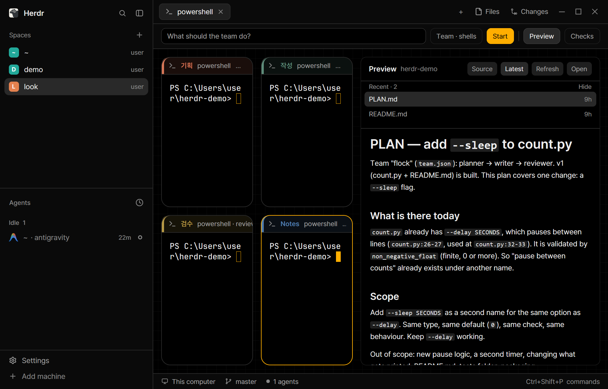

# Preview

The newest output in the folder you are working in, shown beside your agents. When an agent
writes a plan, a report or a picture, it appears here without leaving Herdr: Markdown rendered,
images drawn, text and code read-only, HTML as plain text with one button for the real page.

## What you see

A panel (a rounded card on `background`, 1 px `border`, 13 px text), top to bottom:

1. **Header** (42 px, bottom border): "Preview" semibold, the folder's name in `dim`, then small
   buttons (24 px high, 6 px radius, `raised`, 11.5 px `muted`): **Source** (only for Markdown and
   HTML; `selected` while on), **Latest** (`selected` while following), **Refresh**, **Open**
   (solid, the primary action, when the file is HTML).
2. **Recent** strip: a 24 px line "Recent · N" with Hide / Show at the right; under it up to 40
   rows (26 px, at most 138 px tall, scrolls): file name, its folder in `dim`, age at the right
   (`now`, `5m`, `3h`, `2d`). The shown file's row is `selected`. Hidden, the line shows the
   file's path instead.
3. **The file**, filling the rest:
   - Markdown: rendered (`TextView.markdown`), selectable, 16 × 12 px padding, scrolls.
   - HTML: a dim line saying it is words only, then its text and structure without CSS
     (`TextView.html`, after dropping `script`, `style`, `head`, `svg`, comments). Open shows
     the real page in the browser.
   - Images (png, jpg, gif, webp, svg): a dim line (a new picture may stay blank, Open shows
     it), then the picture in a square as wide as the panel.
   - txt, csv and other text: a read-only code view with line numbers.
   - pdf, pptx, docx, xlsx: a line saying it opens in its own app, and an Open button.
   - Nothing yet: "Nothing to preview yet…" in `dim`.

## How it behaves

- Folder: the focused pane's folder, else the space's. Changing pane or space follows.
- It lists md, markdown, html, htm, png, jpg, jpeg, gif, webp, svg, pdf, txt, csv, pptx, docx,
  xlsx, newest first, three folders deep, skipping hidden folders and `node_modules`, `venv`,
  `__pycache__`, `dist`, `build`, `target`, `AppData`, `Library`.
- **Follows the newest file**: when something in the folder changes (a folder watch, plus a
  15 s timer), the list reloads and the newest file is shown. Clicking a row pins that file
  (Latest turns off); Latest follows again. A pinned file reloads when it changes.
- Refresh reloads now. Open hands the file to the system (browser for HTML).
- Key commands while it shows: `preview.latest`, `preview.refresh`, `preview.open`.
- Words are English, or Korean when `shared("team.lang")` is `"ko"`, `props.lang` says so, or
  the system's language is Korean (labels: 미리보기, 원문, 최신, 새로고침, 열기, 최근).
- What was shown (folder, pinned file, list open) is kept in `localStorage` per copy.
- Props: `{ "folder": "<dir>" }` pins a folder, `{ "file": "<path under it>" }` one file (no
  list, no Latest).

## Built from

- `mods/preview/`: `main.js`, `mod.json` (`place: none`).
- Put it where you like: a block in a side stack (`{ "id": "preview", "type": "block",
  "content": { "mod": "preview" } }`, as Team Cockpit does), or a pane:
  `herdr-app do pane.split '{"direction":"right","mod":"preview"}'`.
- Data: `spaces()`, `panes()`, `focused()`, `theme()`, `settings()`, `window()`, `props()`.
  `readTextFile`, `watchFolder`, `TextView`, `Editor` + `EditorState`, `image`, `nextCommand()`.
- **Runs programs:** to list files, PowerShell on Windows and `sh` (`find`, `xargs ls -t`)
  elsewhere; to show an image, a copy (`Copy-Item` / `cp`) into `mods/preview/shots/`; on Open, `Start-Process` / `open` / `xdg-open`. No network.

## Watch out

- Mods cannot show a web page: HTML is text only here. That is what Open is for.
- `image()` only reads under the app's folder, so a picture is copied to `mods/preview/shots/`,
  named `<hash of its path>-<its time>.<ext>` (found again instead of copied twice; at most 8
  kept). **The app draws such a copy only if it was there when the mod loaded**: one made later
  stays blank until the mod loads again. Tried and not enough: a hidden folder, `data/`, saving
  the file while its element is shown, saving or touching a mod file from the mod. So the panel
  says so above the picture, and Open is the sure way.
- For the same reason a picture of the real HTML page (a headless Edge or Chrome
  `--screenshot`, which works and takes about a second) could not be shown: HTML stays text.
- `fs.readFile` gave empty bytes for binary files here, hence the system copy.
- `on_size_change` reports zoomed pixels: divide by `settings().zoom` before using it as a
  width.
- An image is drawn in a square box as wide as the panel, so a wide picture has space above it.
- On another machine (`on`): text files work through `readTextFile`; images, Open and the folder
  watch are local only (the timer still refreshes).
- The Unix listing has no times (ages stay empty) and was not run by the author; the Windows
  path was.
- `herdr-app check` renders the empty state only (`checking()` skips the folder work).
- A new mod folder is docked once into the shown layout: if a stray block appears at the
  layout's root, remove it.

## Done when

- `herdr-app check ~/.config/herdr-app/mods/preview` passes.
- With the panel shown in a folder that has a Markdown file, the file is rendered and listed
  under Recent.
- Writing a new `report.html` there switches the panel to it within a few seconds; Open shows
  it in the browser; Source shows its code.
- Clicking another row keeps that file while new ones arrive; Latest goes back to the newest.
- A png that was in the folder (and shown once) before Herdr started is drawn.
