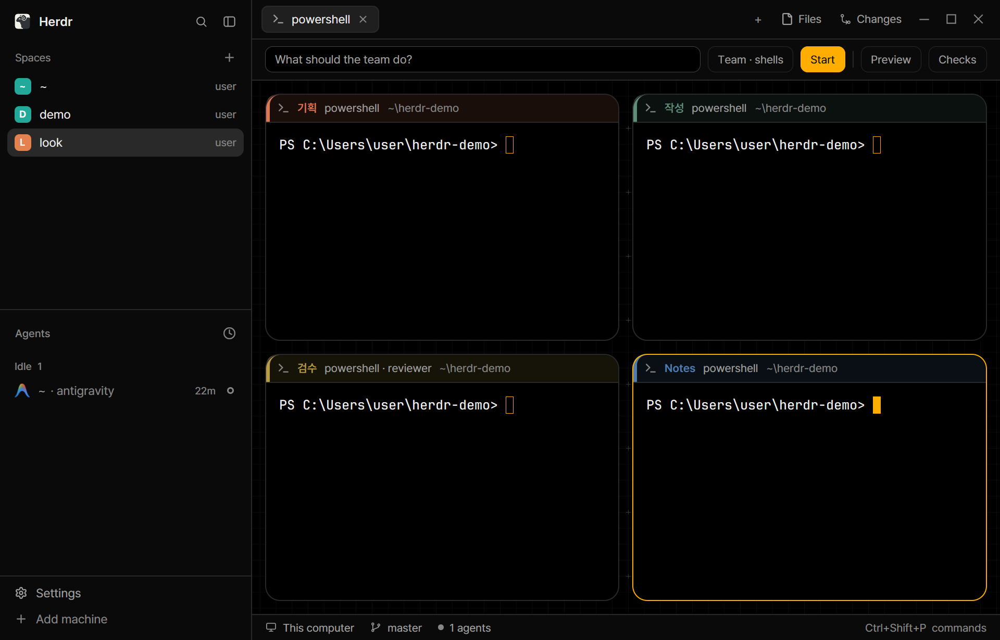

# Team Bar

One row to say what you want and start a team on it. Type the task, pick a team file, press
Start: a new space opens with a grid of agents, each with its role, the task and its name and
color in the pane header.

## What you see

One row (44 px, `chrome`, bottom border, 14 px side padding, 8 px gaps), left to right:

1. **Task field**: takes the free width, 28 px high, 8 px radius, `background`, 1 px `input`
   border (`accent` while focused), 12.5 px text, placeholder "What should the team do?".
2. **Team chip**: "Team · <file name>", or "No team file". 28 px, 8 px radius, 1 px `border`,
   `muted` text on `chrome`.
3. **Start**: solid (`solid` / `solid_foreground`) while a team is chosen; reads "Starting…"
   and turns plain while it runs.
4. A 1 × 18 px divider, then **Preview** and **Checks** chips, only when the layout has those
   panels; the open one is `selected`.

## How it behaves

- Team files, in this order: `<folder>/team.json`, `<folder>/teams/*.json`, then the examples in
  the mod's own `teams/`. The folder is the focused pane's, else the space's.
- Click the team chip: the next team file (it also looks for new ones).
- Start, or Enter in the field: runs `team_start.py <team file> --task "<text>"` in that
  folder. An empty field starts the team with roles only. On success a toast says how many
  panes started and the field clears; on failure the toast shows the script's error.
- Preview / Checks: open that panel, or close it if it is the one showing.
- Key commands: `team-bar.focus` (cursor into the field), `team-bar.start`,
  `team-bar.preview`, `team-bar.checks`.

## Built from

- `mods/team-bar/`: `main.js`, `mod.json` (`place: none`), `team_start.py` (the same script as
  the repo's `scripts/team_start.py`), `templates/` (example roles: planner, writer, reviewer),
  `teams/` (example team files).
- Layout: a fixed-height block, e.g. under the tab bar:
  `{ "id": "team-bar", "type": "block", "size": { "px": 44 }, "content": { "mod": "team-bar" } }`.
  For the panel chips: a node `panel` holding a stack `panel-body` with blocks `preview` and
  `checks`.
- Data: `spaces()`, `panes()`, `focused()`, `layout()`, `theme()`, `window()`, `appHome()`.
  `InputState` + `Input`, `fs/promises` (`readdir`, `exists`), `nextCommand()`, `notify`.
  Commands: `layout.select`, `layout.show`, `layout.hide`.
- **Runs a program:** `python team_start.py …` (`python3` off Windows, falling back to `py` /
  `python`), only on Start. The script drives `herdr-app` and `hc`; see its header for the team
  file format. No network.

## Watch out

- Starting a team starts real agents (Claude Code, Codex, …) with a first prompt: that costs
  what those agents cost.
- Needs Python 3, and `herdr-app` and `hc` on PATH (or `HERDR_APP` / `HC`).
- The team chip cycles; there is no list. Keep few team files per folder.
- `fs` reads under the home folder only: team files in a folder elsewhere are not found.
- Mod commands reach shown copies only, so the key commands need the bar in the layout.
- `herdr-app check` renders the row without a team (`checking()` skips the file lookup).

## Done when

- `herdr-app check ~/.config/herdr-app/mods/team-bar` passes.
- In a folder with a `team.json`, the chip reads "Team · team"; Start opens a new space with
  the grid and labelled headers, and a toast reports the pane count.
- With no team file anywhere, Start shows an error toast and starts nothing.
- `herdr-app do team-bar.preview` opens the Preview panel; again closes it.
