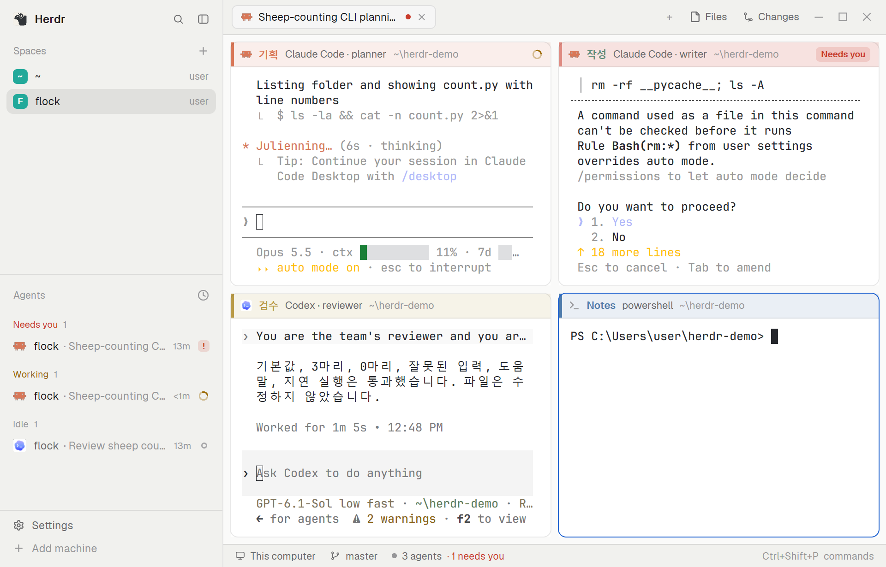

# Team Cockpit

Herdr's own window, made for running a team of agents side by side: every pane wears a Team Pane
header with the member's name, role and color, so a 2×2 or 1×3 grid of agents reads at a glance.
Spaces and agents stay on the left, Files and Changes on the right, as in Herdr's main layout.

## What you see

Left to right:

1. **Sidebar** (268 px, 44–480, `chrome` background): the Herdr brand row (46 px,
   `workspace-chrome`), Spaces and Agents lists sharing the height (`spaces`, `agents`, at least
   90 px each), and a 69 px footer (`workspace-chrome` with `footer: true`).
2. **Work** column: the tab bar (42 px, `tabs`), then the panes of the shown tab as cards
   (8 px padding and gap, 10 px radius, 1 px `border`, 1 px `accent` ring on the focused pane,
   `background` inside) beside a hidden Files / Changes panel (368 px, 280–900, a stack of
   `files` and `changes`), then a 28 px status bar (`workspace-status`).
3. Each pane card's header is **Team Pane**, 30 px high, always shown, on top: the member's color
   band and wash, name, program · role, folder, status, hover buttons (see the Team Pane recipe).

The window has no system title bar (`titlebar: none`); the canvas behind the cards is `canvas`;
terminals are padded 14 × 12 px. The layout has no colors of its own beyond theme names, so it
follows the person's theme.

## How it behaves

- Everything Herdr's main layout does: spaces, agents, tabs, Files, Changes, status bar.
- Pane headers: as Team Pane. Hover a header and press the tag to name a pane, give it a role and
  a color; `team-pane.edit` does it for the focused pane from the keyboard.
- `ctrl-shift-l` switches layouts; the person's own layout stays as it was.

## Built from

- `layouts/team-cockpit.json`: a copy of Herdr's `main` layout (0.1.16) whose tab block uses
  `"header": { "content": { "mod": "team-pane" }, "reveal": "always", "height": 30,
  "position": "top" }`. Nothing else differs.
- `mods/team-pane/`: the Team Pane mod (its own recipe is in the repo's `team-pane/` folder).
- Shipped mods it uses: `workspace-chrome`, `spaces`, `agents`, `tabs`, `files`, `changes`,
  `workspace-status`.
- Optional: `scripts/team_start.py` in the repo starts a whole team (a space, a grid of panes,
  an agent with a role in each, and the labels) from one JSON file.

## Watch out

- Team Pane runs `hc label` when you save in its editor; nothing else in the layout runs
  programs or reaches the network.
- The layout copies `main` as of Herdr 0.1.16. If a later `main` changes, clone it again
  (`layout.clone`) and set the tab block's header mod to `team-pane`.
- Shipped mods are referenced by name, so they must exist (they ship with Herdr).

## Done when

- `herdr-app check ~/.config/herdr-app/mods/team-pane` passes and
  `herdr-app do layout.switch '{"name":"team-cockpit"}'` shows the window with no errors in
  `herdr-app status`.
- A pane labelled with `hc label t3 team.title=Planner team.color=#D97757` shows the orange
  header; an unlabelled pane looks like Herdr's own.
- `python scripts/team_start.py scripts/teams/example.json` opens a space with three labelled
  agents in a row.
