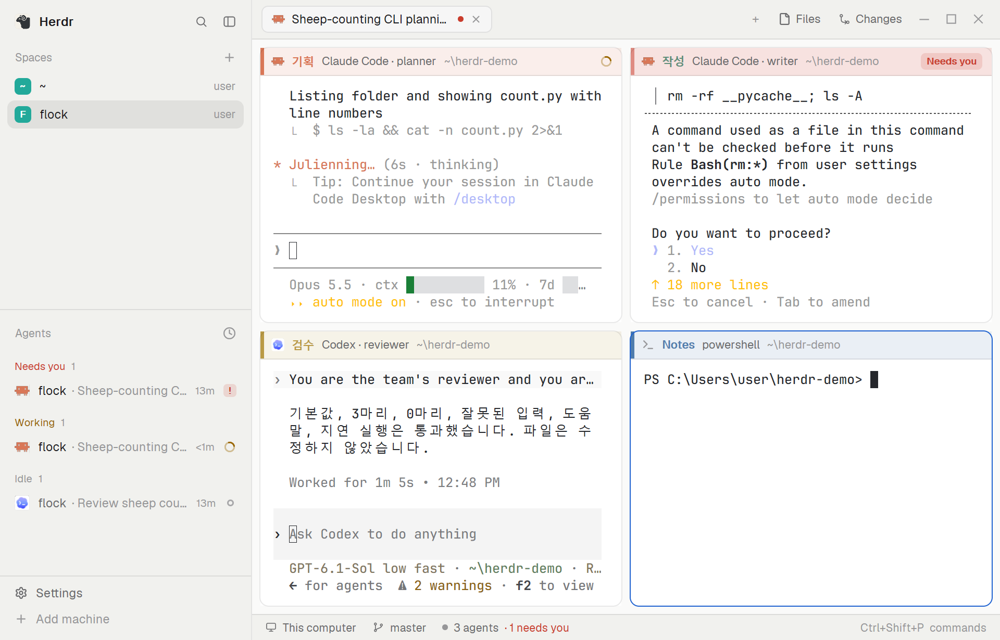

# Team Pane

A pane header that tells you which team member each pane is. Every pane can carry a name in
any language, a role and a color. The header takes that color and shows the agent's state, so a
grid of agents reads at a glance: who is working, who is done, who needs you. Labels live on the
terminal, so they survive restarts and show on every Herdr client.

## What you see

One row, the full width of the pane's header (30 px in Team Cockpit), 12 px text, left to right:

1. **Band**: 4 px wide, full height, flush left, following the card's rounded corner. The
   member's color. Breathes while the agent works; turns the theme's `blocked` color and breathes
   faster when the agent needs you.
2. **Program icon**: 14 px, from the app's program table (tinted `dim` when it is a glyph).
3. **Name**: semibold, at most 260 px, truncated. The member's name in their color (on a dark
   theme lifted 30% toward white so it stays readable), else the agent's or terminal's name in
   `foreground`.
4. **Program · role**: only when the pane has a member name. `muted`, at most 160 px:
   `Claude Code · planner`, or just `Claude Code` without a role.
5. **Folder**: `dim`, takes the rest, truncated; the home folder shows as `~`.
6. **Status**, at the right: working = a 12 px ring spinner in `working`; blocked = a "Needs you"
   pill (18 px high, 10.5 px semibold, `blocked` text on `blocked` at 15%); done = a 7 px dot in
   `done`; idle = nothing.
7. **Hover buttons** (14 px icons, 3 px padding, `dim`, `hover` background): tag (edit team),
   split right, split down, zoom/unzoom, close.

Background: the member's color at 12% (`#rrggbb1f`); the `blocked` color at 15% while blocked;
else `background`. A 1 px `border` line under the header (above it when the header sits at the
bottom). The header's outer corners take the pane frame's `radius` minus its border width, so the
wash never pokes past a rounded card.

The **team editor** is a 300 × 330 popup on `popover`, 16 px padding: title "Team" (14.5 px
semibold) with the terminal's address on the right; fields **Name** and **Role** (34 px high,
8 px radius, `accent` border while focused); **Color**: eight 22 px dots (`#D97757 #5E8D7A
#B99A45 #4F7CAC #8E6BB8 #C2577A #3E9AA6 #7A7F87`), the current custom color if it isn't one of
them, and a "–" dot for no color; the chosen one has a 2 px `foreground` ring. Buttons: Clear on
the left; Cancel and Save (solid) on the right.

## How it behaves

- Click the header: focus that pane. Hover: the buttons appear.
- Tag button: the editor opens at the pointer with the pane's current labels filled in.
  Enter in either field or Save writes them; an empty field removes its label; Clear removes all
  three; Esc or Cancel closes without saving. The header updates as soon as the labels change.
- Key command `team-pane.edit`: the same editor, centered, for the focused pane. Bind it in
  `keys.json` (the shipped `keys.json` suggests `ctrl-shift-m`).
- Status follows the agent: working (band breathes 0.35 → 1 opacity every 1.6 s, spinner),
  blocked (band and wash turn `blocked`, band breathes every 0.7 s, "Needs you"), done (dot),
  idle (plain). A pane without a member color still gets the band while working (`working`
  color) or blocked.
- A pane whose terminal has no labels looks like Herdr's own pane header plus the status band.

## Built from

- `mods/team-pane/`: `main.js` (the header, and the editor when `props().edit` is set),
  `editor.js` (the editor), `mod.json` (`place: none`), icons `tag split-right split-down zoom
  unzoom close` (.svg, `currentColor` strokes). Started as a clone of Herdr's `pane` mod.
- Layout: any layout whose tab block uses it as the pane header:
  `{ "tab": "active", "pane": { "header": { "content": { "mod": "team-pane" } } } }`.
- Uses the shipped `mods/workspace-chrome/spinner.svg` for the working spinner.
- Data: `panes()` (its pane via `props().pane`), `terminals()` (labels of `props().terminal`),
  `theme()`, `home()`, `layout()` (header position). Commands: `pane.focus`, `pane.split`,
  `pane.zoom`, `pane.close`. `openOverlay` (popup or dialog, `mod: "team-pane"`,
  `props: { edit: { terminal, title, color, role } }`), `nextCommand()`, `focused()`.
- Labels on the terminal: `team.title` (shown name), `team.color` (`#rrggbb`), `team.role`
  (free text). Written with `hc(["label", <terminal>, "team.title=…", "team.role=…",
  "team.color=…"])`; `key=` removes a label. Errors become an error `notify`.
- **Runs a program:** `hc label` (herdr-core), only when you save or clear in the editor. No
  network, no files outside its folder.

## Watch out

- The editor needs the pane's terminal address; a mod pane (no terminal) shows no tag button.
- Labels are per terminal, not per pane: a terminal shown in another pane carries its team along.
  Remote terminals use their `machine/t7` address, which `hc label` accepts.
- `init(props, cx)` decides the role: with `props.edit` it is the editor, otherwise the header.
  Build both from one class; Herdr opens the overlay with the same mod name.
- Animate the band with `.loop("opacity", …)`, never a timer.
- Children are not clipped to a rounded parent (`overflow_hidden` doesn't help), and a 4 px
  element can't take a 16 px corner. So the band is two absolute layers inside a `relative()`
  header: a band-colored piece `r + 8` px wide with the corner radius `r`, and over it, 4 px in, a
  piece in `background` with the wash on top, radius `r - 4`. A 4 px in-flow spacer keeps the
  content where the band was. Only the band piece breathes.
- The radius comes from `layout()`: the tab block's `pane.radius` minus `pane.border.width`.
- `herdr-app check` renders only the header; open the editor once by hand to test it.
- Colors must be `#rrggbb` (or `#rrggbbaa`); anything else is ignored.

## Done when

- `herdr-app check ~/.config/herdr-app/mods/team-pane` passes.
- With a layout using it, `hc label t3 team.title=Planner team.color=#D97757 team.role=planner`
  turns that pane's header: orange band, light orange wash, "Planner" in orange, then
  "<program> · planner".
- Hovering shows five buttons; the tag opens the editor filled with those values; Save with
  another color repaints the header; Clear returns it to the plain look.
- `herdr-app do team-pane.edit` opens the editor centered for the focused pane.
- An agent that is working shows the breathing band and spinner; one waiting for you shows the
  red band and "Needs you".
